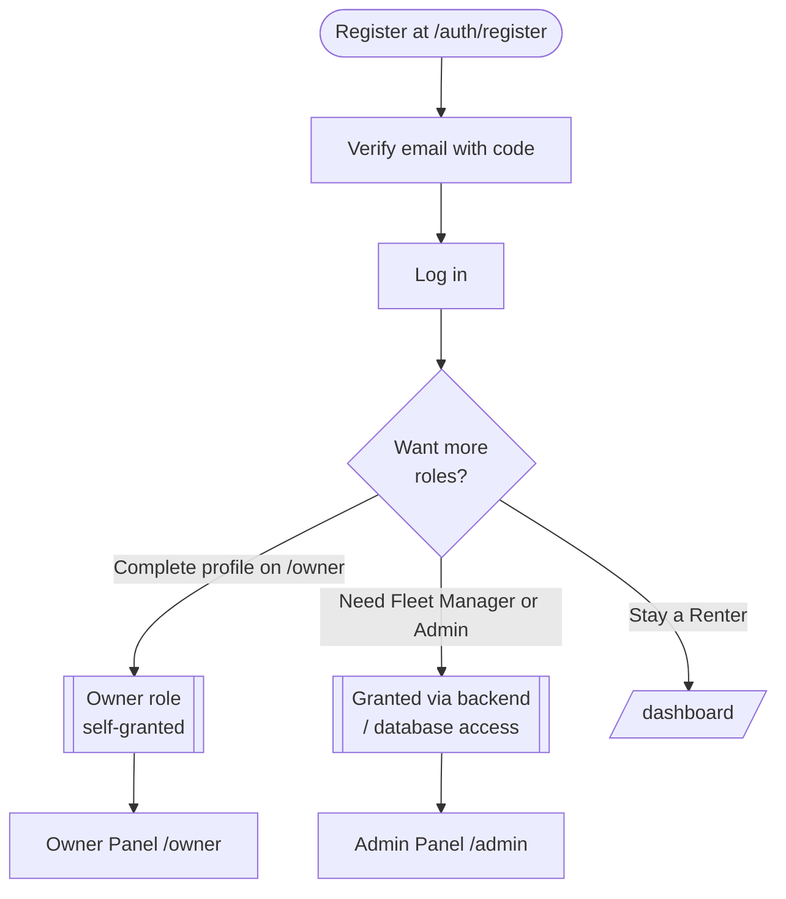
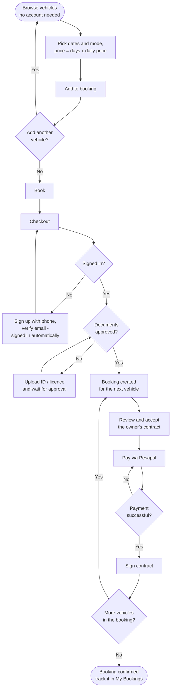
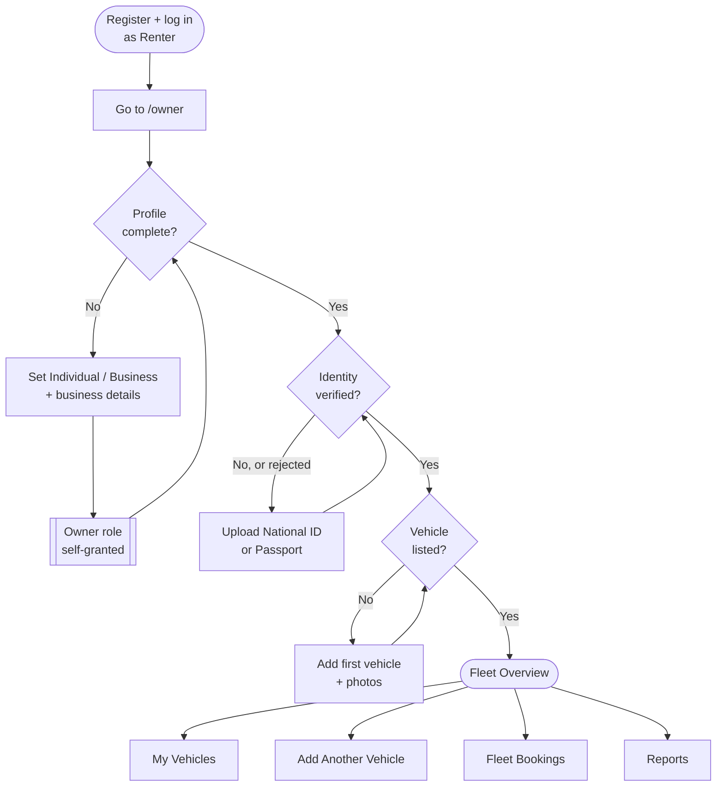
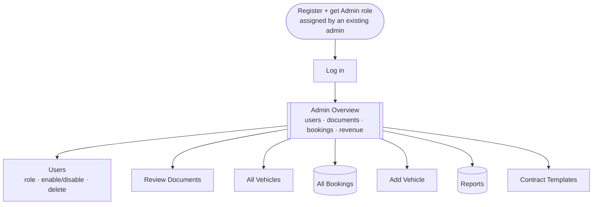

# Portal User Guide

How to use the Ramellian Executive Travels portal, by role.

## Overview

Every account is created through the **same public sign-up form** — there is no
separate registration path per role. The form asks only for your name, email and
password, plus a required **"I agree to the Terms of Service and Privacy Policy"**
checkbox linking to the real `/terms` and `/privacy` pages — the account can't be
created until it's checked. Whether you're an **Individual** or a **Business** is
chosen later, when you complete your profile, and decides which details and documents
you're asked for (see "Guided setup" below).
An account can hold more than one role at once (for example Renter **and** Owner
on the same login), and each role you hold unlocks its own area of the portal.

How you get each additional role differs:

- **Car Owner** — earlier testing showed that saving the owner profile on `/owner`
  (any signed-in account can reach it) added the Owner role automatically. On the
  current backend, though, a test account already held the `CAR_OWNER` role before it
  had any owner profile, so **how the role is granted today is unconfirmed** — if you
  can't see the Owner Panel, ask an administrator to check your roles.
- **Fleet Manager and Administrator are not self-service.** Those still need to
  be granted through backend/database access.

Everyone logs in at the same page — **email and password, nothing else** — and the account itself decides
where you land (see "How signing in works" below). Which extra panels show up in the account menu depends on which
role(s) are on your account:

| Role on your account | Extra panel in account menu |
| --- | --- |
| Renter | (none — `/dashboard` is the renter view) |
| Car Owner or Fleet Manager | Owner Panel → `/owner` |
| Administrator | Admin Panel → `/admin` |

If your account holds more than one role, every matching panel link shows up at
once — e.g. an account with Renter + Owner sees both the renter dashboard and the
Owner Panel link. Your role(s) also show as a badge next to your name in the account
menu, so it's easy to confirm which ones are on your account.

The top bar is a single line. The logo is always at the top left. At the far right end are the **About**
and **Contact** links, and just before them — depending on whether you're signed in:

- **Not signed in:** the two quick-entry buttons **Rent a Car** (goes to `/vehicles` to browse) and **Rent
  Out My Car** (goes to Register), followed by a **Log In** button (always visible — on a phone it stays in
  the bar next to the menu icon, it isn't tucked inside the drawer). See the Renter and Car Owner guides
  below for what happens next.
- **Signed in:** those buttons are gone. You see the **bell** (your Inbox, with the number of
  unread notifications) and your account avatar. You can still browse from **Browse Vehicles** in the
  side menu, and there is no "List Your Car" prompt once you're signed in.

Once you've added a vehicle to a booking (see the Renter Guide), a **shopping-bag icon** with the number of vehicles
appears in the top bar for everyone, signed in or not, and opens your booking. It is not shown while your booking is empty.

In the left menu, **Profile** is always the item right below **Overview**. When you're signed in, the logo in the
top bar sits in a column the same width as the left menu, exactly at the top of it, on the same line as About and
Contact.

**Administrators.** The backend can give an account the roles `SUPER_ADMIN` and `MANAGE`; the portal treats a
super admin as an **Administrator** and a `MANAGE` account as a **Fleet Manager**. An administrator always gets
the **Admin Panel** menu — Overview, Profile, Messages, Inbox and Assistant, then the platform tools under an
**Administration** heading (Users, Roles & Permissions, All Bookings, Reports, Contract Templates, Audit Log, Announcements),
the vehicle tools under a **Vehicles** heading (All Vehicles, Add Vehicle, Vehicle Approvals, Approved Vehicles, Rejected
Vehicles), the
document tools under a **Documents** heading (Review Documents, Approved Documents, Rejected Documents), plus
**My Vehicles** and **Fleet Bookings** under a **My Fleet** heading if they also own vehicles.

**Menus for people with two roles are grouped.** Instead of one long list, related items sit under a heading
you can click to fold or open (**Administration**, **Vehicles**, **Documents**, **My Fleet**, and for an owner who also rents
**My Rentals**), each with its own icon.
The heading holding the page you're on is open by itself and the others are folded away. Menus for a single role
aren't grouped. On a phone the same menu opens from the left: tap **☰** at the top-left corner. It slides in with your
photo and name, the whole menu (headings included) and, underneath, **About**, **Terms & Conditions**, **Privacy
Policy** and **Contact**. Tapping a page, **✕**, the dimmed page beside it or Escape closes it. Visitors' ☰ menu opens
from the left too. On a big screen **About**, **Terms & Conditions**, **Privacy Policy** and **Contact** are at the right
end of the top bar; on smaller ones they're in the ☰ menu.
Once you're signed in, a phone also shows a dark bar floating along the bottom of the screen with five shortcuts —
**Home**, **Search** (Browse Vehicles), **Messages**, **Inbox** and **Profile**. The one you're on is lit up, and
Messages and Inbox show how many unread items you have. It is extra to the menu, not a replacement for it.

**How signing in works.** The login page asks only for your email and password — there is no "log in as"
choice. **Forgot password?** (under the password box) opens a page that emails you a 6-digit code: enter it with a
new password (same rules as signing up) and you're taken back to Log In with your email already filled in. **Send
the code again** sends a fresh one. The page never says whether an email has an account. The roles on your account decide where you land:

| Who signs in | Lands on |
| --- | --- |
| Administrator or Super Admin | Admin Panel (`/admin`) |
| Car Owner or Fleet Manager | Owner Panel (`/owner`) — or the renter Dashboard, if that is the side they last used on this browser |
| Anyone else (a renter — the backend gives a plain renter no role at all) | Renter Dashboard (`/dashboard`) |

If your account can be both an owner and a renter, you're never stuck: the left menu has a **Switch to
Renter** / **Switch to Car Owner** item that changes sides without logging in again, and the portal remembers
the side you were on (per person, on this browser) so your next login opens there. Administrators have no
sides. The same landing applies after two-factor verification. The exception is **List Your Car**: a visitor
who came in through that button (it opens Register with `?as=owner`) lands on the Owner Panel's setup steps at
their next login, whatever roles they have yet (administrators still open the Admin Panel).

**Once you're signed in, the left menu is on every page** — including browsing and viewing vehicles, About,
Contact, the booking steps, the Inbox and Messages — and it is **always the same menu**. Which one you get
depends only on who you are and how you logged in, never on the page you're on: an administrator gets the
Admin Panel menu, a car owner the Owner Panel menu (with **My Bookings** added if you also rent cars) — or the
renter Dashboard menu if that is the side you're using — and anyone else the renter Dashboard menu. So clicking Profile, Documents, Inbox or Browse Vehicles from the Owner Panel keeps the Owner
Panel menu. (Visitors don't get it.) The side menu in the dashboard and Owner Panel starts with your profile photo and name (click it to open
your Profile); the logo is in the top bar, so it isn't repeated. The **Inbox** opens inside the same side menu
you were in (renter, owner or admin), so the menu doesn't disappear when you open it.

**What you see in the left menu also follows your permissions.** Your role picks the menu; the permissions the
backend gives your account then decide which of its items you see: **My Bookings** needs permission to read
bookings; **Documents** needs document read or upload; **My Vehicles** needs permission to create, update or
manage vehicles; **Add Vehicle** needs create or manage vehicles; **Fleet Bookings** and an owner's **Reports**
need read or manage bookings; an administrator's **All Bookings** and **Reports** need manage bookings.
Overview, Profile, Messages, Inbox, Assistant, Browse Vehicles and the switch items are always there. If your account
carries no permission list at all, the menu follows your role alone. (Only the menu changes for now — a page
you open by its address is still decided by your role.)

**Inbox and notifications (`/inbox`, the bell, and *Inbox* in the side menu):** the backend creates
notifications — an owner gets a "New booking request" when a renter books one of their vehicles, and both
sides are told as a booking moves on or a message arrives. The bell in the top bar and the *Inbox* item in
the side menu show how many are unread (the portal checks every 30 seconds). A booking notification shows
that booking's vehicle photo and a labeled button — **Review Booking** for an owner's new booking (that's
where **Accept**/decline actually happens), **View Booking** otherwise, **Reply** for a message — that opens
what it's about and marks it read; **Mark all as read** clears the count in one go.

**Messages (`/messages`, the speech-bubble icon in the top bar, and *Messages* in the side menu):** renters
and owners can talk to each other about a booking. **Message the owner** (on a renter's booking page) and
**Message the renter** (on an owner's booking page) open that booking's conversation; the Messages page lists
every conversation with the vehicle, the last message and how many are unread. Conversations refresh every
few seconds while open, your replies show on the right and theirs on the left, and their messages are marked
read as you see them. You can't message yourself. **Administrators can also start a new conversation with anyone:**
on the Messages page, **New message** opens a window — search for a person by name or email (switched-off accounts
and yourself aren't offered; the first 8 matches are shown), pick them, write, and **Send message**; you land in
that conversation. The same conversation opens from **Message** on a person's page under Users. Only administrators
get **New message**, because finding a person uses the administrator's account list — everyone else starts
conversations from their bookings. To write to a whole group at once, use **Announcements** (Administrator Guide).

**Assistant (the green WhatsApp-style button in the bottom-right corner of every page — visitor or signed
in — plus `/assistant`, the bot icon in the top bar, and *Assistant* in the side menu once you're signed
in):** a chat with Ramellian's own bot — ask about a vehicle, a booking, or how something on the portal works,
and it can reply with text and, where relevant, an attachment (an image shown inline, or a file as a download
link). The floating button is the quickest way in, and the only one a visitor gets: click it to chat right
there in a small panel without leaving the page, click it again to put it away. Opening it before you've
signed in offers **Log In**/**Create Account** instead of the chat box — the assistant itself needs an
account. Unlike Messages, this isn't a saved conversation between two people: the backend doesn't keep a history of
it, so it starts fresh every time you open it, and reloading the page loses whatever you'd asked.
An administrator can switch the assistant off (**Platform Settings → Assistant**); while it's off, signed-in people
don't see the button, the top-bar icon or the menu item, and `/assistant` says it's switched off.

**No phone numbers, anywhere.** Phone numbers can't be shared through the portal. Anything that
looks like one — a number starting `07` or `01` (including `011`), or with a country code such as
`+254`, `00254` or `254`, however it's spaced or dashed, or spelled out in words — is removed from
the special instructions a renter writes, in every chat message (as you type, when it's sent, and when
it's shown) and in notifications, and replaced with "[phone number removed]". You're told when one was
removed, and the notice stays while you keep typing.

**Guided setup right after you sign in:** if the backend says something on your
account is still missing, a setup window opens straight away and walks you through
it, one step at a time:

1. **Profile** — pick **Individual** or **Business** (this is the only place it's
   asked). The profile fields are **the same for car owners and renters**,
   and come straight from the backend's own API definition: first name, last name,
   phone number and location, plus payout provider and payout account reference
   (where any earnings are sent). The **ID number** is shown but can't be edited — it's
   read from your National ID or Passport photo when you upload it under Documents. A Business also has business
   name, registration number, tax number (KRA PIN), and address — a business **does
   not have to be a limited company**. The **phone number is mandatory** (marked with a `*`;
   the form won't save without it, and the setup window and banner keep asking until
   it's filled in). The backend's own definition marks none of the fields as
   required, so nothing else is forced; only its length limits are enforced (for
   example, a phone number is at most 30 characters).
   Once your account type is saved the portal stops asking for it (it no longer
   waits for the backend's own "profile complete" flag, which stays off even after the
   type is saved). (The backend also
   has fields for the front and back of your ID and a profile photo, but they take
   image *links*, and nothing in the portal produces one, so they aren't offered.)
2. **Documents** — upload right in the window. The only required document is an
   identity document: pick **National ID** or **Passport**, whichever you have — one is
   enough, you never need both. For a National ID you add four photos: the front, the
   back, a **selfie holding the front** and a **selfie holding the back**. For a Passport
   you add two: the photo page and a **selfie holding the photo page**. (On a phone the
   selfie buttons open the front camera; on a computer they open a camera window using the webcam — allow the
   camera when the browser asks — with **or upload a photo** underneath if you'd rather.) The selfies let an administrator check the
   document belongs to you. Your **ID number** (or passport number) is **read off the
   photo automatically** and can't be typed or changed. If it can't be read, you're asked
   to retake a flat, well-lit, in-focus photo. All the photos go to the reviewer together
   as one image.
   A **Proof of Address** is optional for everyone. A **Driving Licence** is only
   asked of accounts that rent cars (car renters), since it's for self-drive
   bookings — an owner-only account never sees it. A Business can optionally add
   its **Business Registration Certificate** and **Tax Certificate** if it has them
   (sole traders and other unregistered businesses can skip both). Only images and
   PDFs are accepted. The step clears once the identity document is in (it can
   still be pending review). Once an administrator decides it, the status on your
   own Documents page updates on its own — it checks every 15 seconds (and the
   moment you switch back to the tab) while the page is open, so you don't have to
   reload to see "Pending" turn into "Approved" or "Rejected".
3. **Vehicle** (car owners only) — a button straight to the add-vehicle form.

**Not signed in?** Visitors who aren't logged in always land on the **main page**
(`/`). That includes opening or refreshing a signed-in page such as `/dashboard` —
you're signed out on refresh, so you're taken to the main page rather than a login
form — and being signed out because your session expired (you'll see a short notice).
Log in from the navbar whenever you're ready.

**It never makes you start over.** The window opens on the first step that's still
unfinished, not on step one, and after you save a step it takes you to the next step
you haven't done — skipping anything already finished. The step bar at the top shows
which steps are done (a tick) and which are still to do. **Every step stays open**:
tap any step in the bar — finished or not — to fill it in or change it later.
**Do this later** moves past a step without saving it, and the banner below keeps
reminding you. When nothing is left, the window closes by itself (and the Profile page
says "Everything is set up").

The account type and the personal details are saved by two separate backend calls.
If one of them is refused, the window stays on that step so you can see the error.

If a save fails, the exact reason from the server is shown in the window (and on
the Profile page). If the server itself errors (an HTTP 500), you're told it's a
problem on the server side rather than something you did. **Remind me later**
closes the window for the rest of your session.

**"Finish setting up" banner:** whether or not you close the window, a grey banner
under the navbar keeps reminding you while something is still missing — **Complete
profile**, **Upload documents** (it lists what's missing), and, for car owners,
**Add a vehicle**. Each prompt disappears on the page it links to, clears itself
once done, and can be dismissed with the **×** for the rest of your session.

You can do all of this any time from **Profile** (`/dashboard/profile`), which has
the account type, business and personal details, and the document uploads as the same
steps — it also opens on the first step you haven't done, and lets you edit any step; **Documents** (`/dashboard/documents`) shows just the uploads. Both are also
in the Owner Panel sidebar.

> **Role names:** the backend calls a car owner `CAR_OWNER`; the portal treats that
> the same as Owner everywhere (Owner Panel access, badges, prompts).

**Security (bottom of the Profile page).** Everyone can: **change their password** (current password, then a new
one of 8–72 characters, typed twice); turn **two-factor sign-in** on or off (a code is sent by email each time
you log in — WhatsApp is offered only when WhatsApp is switched on); and see their **recent activity** (the last
few sign-ins and changes on the account — click one for its details). If the backend refuses a new password,
its reason is shown under the current-password box.

**Profile picture:** on `/dashboard/profile`, click the camera icon on your avatar
to upload one — it shows immediately there and in the account menu. There's no
backend endpoint to store a profile picture yet, so this is local to your current
browser only: it won't follow your account to another device or browser, and is
lost if that browser's site data is cleared.

---

## Renter Guide

Every account can act as a renter once it registers — browse vehicles, upload
identity documents, and book a car for self-drive or chauffeured trips. The
**Rent a Car** button in the navbar (shown to visitors; once you're signed in, use **Browse Vehicles** in the side menu) takes you straight to browsing (`/vehicles`).
> Visitors can browse without logging in (re-tested live 2026-09-24, after the backend fix —
> an earlier version refused them). If the backend ever refuses a visitor again, Browse Vehicles
> says "Please log in to browse vehicles". Vehicle lists are fetched fresh every time you open
> them, so a car an owner has just switched on appears straight away.
>
> **Browse Vehicles** and **Our Fleet** show 12 cars at first and load the next 12 as you scroll down. **Show more
> vehicles** at the end of the list does the same. The "… vehicles found" count is the full number that match,
> not just the ones shown so far. **Change vehicle** on a booking lists the cars the same way, with **Show more
> vehicles** at the bottom.

**You don't need an account to choose a vehicle.** The account comes at checkout: you find vehicles, put the ones
you want in your booking, see the price, and only then sign up. Your booking is saved through registering and
verifying your email (which signs you in), and picks up where you left off.

1. **Browse vehicles** — open a vehicle to see everything about it: model, location,
   rating, fuel, transmission, seats, colour, self-drive / chauffeured, air conditioning,
   comprehensive insurance, the trip types it suits, when it's available (any time, or
   between set dates), and the daily price. Search and filter by location, dates, seats,
   fuel type, transmission, and self-drive vs. chauffeured.
   **Browsing (`/vehicles`):** the filter panel has **Available in** — every place vehicles are available,
   with how many are in each (click one to see only those; click again to clear) — and a **Price per day**
   slider with two handles for the lowest and highest price you'll pay (drag them, or use the arrow keys;
   the results update when you let go). The results are one grid — not split up by place — with each car's
   place on its card; use **Available in** to narrow to a place. The grid follows the **Sort by** order.
   **Searching from the home page:** give the **Pick-up Location** and your dates. Browse Vehicles then shows the cars
   based near that place first (any area named in it counts — "Eastleigh, Nairobi" finds cars in Eastleigh and in
   Nairobi), with **Show all** to see every car; if none is based near it, it shows every available car and says so.
   The place is also filled in as the pick-up location when you book. Returning the car somewhere
   else? Click **Return to a different location** under the search bar to add a **Return Location**
   (**Return to the same place** removes it again).
   The search box and filters stay in view while you scroll the vehicles. The full-width search box stays
   pinned under the top bar. On a wide screen the filters are a column beside the results that stays put just
   below it (scrolling on its own if it's taller than the screen); on a narrower screen a round filter button
   sits beside the search box and opens the full panel right there, with a small count of how many filters are on.
   **Order (Sort by):** **Recommended**, the default, shows vehicles free for your dates first, then the
   highest rated, then those with photos, then the newest. **Newest** puts the most recently listed first.
   Price, Top Rated and Most Seats sort by just that. A vehicle listed in the last 7 days (counted from when
   it was approved) has a green **New** badge on its card.
   **On the home page**, below the search bar, real vehicles are shown in swipeable rows — **Available now**,
   **Just added** (newest first), **Chauffeured** and **Self-Drive** (swipe on a phone, or use the arrow buttons). **See all** opens Browse
   Vehicles with that row's filter. A row with no vehicles in it isn't shown.
   **Searching from the home page:** what you choose in the search bar (pick-up and return place, dates and
   times, Self-Drive or Chauffeured) filters the results, and is filled in for you on whichever vehicle you open
   — you don't type it again. (Opening Browse Vehicles any other way, e.g. from a bookmark, still starts with
   no filters.) Dates that have already passed aren't carried over, and if the vehicle doesn't offer the mode
   you searched for, it starts on the one it does.
2. **Book it** — on the vehicle's page, check your dates, **Self-Drive** or **Chauffeured** (a
   vehicle that only offers one has it chosen for you), an optional trip type (tap one) and, if you need them,
   special instructions (**Add special instructions** opens the box), then either:
   **Travelling from** and **Travelling to** are required: where your trip starts and where you're going (not the same
   as where you collect the car). They're written into the contract.
   The whole booking panel fits on screen beside the vehicle, so **Book now** is always visible without scrolling. On a
   phone or tablet, where the panel comes after the vehicle's details, the price, **Book now** and the basket button
   (**Add to booking** / **Update booking**) float along the bottom of the screen until you reach the panel — if
   something is missing (your dates, say), tapping them brings the form into view and says what to fill in. Checkout
   does the same with the total and **Continue** (or **Sign up** / **Log in**).
   - **Book now** — goes straight to checkout. If you're not signed in, choose **Sign up to continue** or **I have an
     account** there (nothing opens by itself). Anything else already in your booking comes along too.
   - **Add to booking** — puts it in **Your Booking** (step 3) so you can add more vehicles first.
   **Getting the vehicle** (self-drive only — a chauffeur brings the car, so a chauffeured booking doesn't ask):
   choose **I'll collect** (no fee — you pick it up yourself) or **Deliver** (a flat delivery fee, shown right there
   once your dates are chosen, is added to your total). If you collect it, there are no pickup or drop-off boxes:
   you collect it from and return it to the vehicle's own location, which the form shows. For delivery, you give the
   **Delivery Address** (required) and a **Drop-off Location**. A chauffeured booking asks for the **Pickup
   Location** and **Drop-off Location** — where the chauffeur meets you and drops you off. Your booking and
   checkout show which you chose ("Getting the vehicle") and the fee. Administrators set the fee under
   **Platform Settings → Delivery fee** (0 means free delivery).
   Each trip type has its own icon: General (a route), Airport Transfer (a plane), Wedding (a ring), Corporate (a
   briefcase), Safari (binoculars), Family Journey (people), Self-Drive Rental (a steering wheel) and Cake
   Transportation (a cake). The same icons show in a vehicle's **Suited for** list, the trip-type choices when adding
   or editing a vehicle, and the booking details.
   Trip Type only offers what this particular vehicle is set up for (see its **Suited for** list). A vehicle
   whose list includes **General** — or that the owner hasn't restricted at all — is fine for any trip, so it
   offers all of them (a Wedding on a General car is allowed). Owners: tick **General** for an all-purpose car;
   leave it off only if the car really is limited to the specific trips you tick.
   The price is worked out as you choose: the number of days × the daily price (every started 24 hours counts as a
   day, and a same-day trip is one day). It is an *estimate*: the final amount is confirmed when the booking is
   created. Phone numbers typed into the notes are removed, as everywhere in the portal. If you already have a real
   booking for this vehicle, the button instead says **Book Again**, with a note that your existing booking is
   untouched — choosing different dates starts a separate, new one.
3. **Add more vehicles if you like** — **Your Booking** (`/booking`, also the shopping-bag icon in the top bar) lists
   every vehicle with its own pickup and return date *and time*, days × price and the estimated total for all of
   them. **Add another vehicle** goes back to browsing; **Edit** reopens a vehicle's dates; **Remove** takes it out —
   even one whose booking has already started (a confirmation explains it stays in My Bookings, to cancel from
   there if you want it gone entirely, not just out of this list). **Clear booking** removes everything at once,
   with the same confirmation. Your choices are kept in this browser, so closing the tab doesn't lose them — but
   that also means a trip's start time can lapse into the past if it sits there long enough (see step 5). Adding
   the same vehicle again with the same dates just leaves its entry as it was; with different dates (or after Book
   Again), it's a new booking alongside — or, before it's actually paid for, in place of — the old one.
4. **Book** — **Book** on Your Booking goes straight to checkout, the same as **Book now**. There's no separate
   "How can we reach you?" step any more: signing up asks for your phone number (see step 5), and the old
   `/booking/contact` address now opens checkout.
   Dismissing a sign-up or log-in panel — clicking outside it, pressing Escape, or its **X** — doesn't throw away
   what you were doing: a small **Continue: …** tab, named after the panel it reopens (e.g. **Continue: Log
   In**), stays docked to the right edge of the screen, and clicking it reopens the same panel (starting
   fresh, the same as opening it again normally — nothing you'd already typed is kept).
5. **Checkout** (`/booking/checkout`) — one last look at what you're booking, the total, and what happens
   next. A **Price breakdown** shows what you're paying for, from the backend's own quote: the rental (days × daily
   price), and — when they apply — delivery, a driver, and the payment processing fee, adding up to the total
   you'll pay. With several vehicles, each has its own breakdown and subtotal. Your Booking shows the same
   breakdown. (The platform's commission is not a line: it comes out of the owner's earnings, not your price.) Arriving from **Book** or **Book now**, a visitor finds **Create Account** already open (**Sign up to
   continue** and **I have an account** reopen either one) — as a panel that slides in from the right, so your
   booking stays visible behind it. Sign-up asks for your name, email, **phone number** (required, never shown to
   vehicle owners), and a password. As soon as you submit it, the business is told which vehicles you were
   booking, with your email and phone, so it can follow up if you don't finish. Registering moves on to the
   **Verify your email** page (there's a code to type in); once the code is accepted **you're signed in
   automatically** — no logging in again — your phone number is saved to your profile, and you land back here
   with your booking waiting. (If you reload the verify page first, you're asked to log in instead.) Logging in
   from the panel needs no extra step — it signs you in right there and the panel just closes.
   While you're booking (checkout, contract, payment, signing), the **Finish setting up your account** window and
   banner stay out of the way; they come back once you leave the booking pages.
   Before **Continue to contract**, tick **I have read and accept the Terms of Service and the rental terms**
   (**Read them** shows the terms for renters).
   Each vehicle is checked again against its live listing: if it's no longer available, is your own, isn't offered in
   the mode you chose or can't be booked on those dates, you're told and must remove it to go on; if its daily price
   changed you see the new price. If a vehicle's start time has passed since you added it (the selection is kept in
   this browser and can sit there a while), you're told that too — **Edit** it to choose new dates rather than
   starting over.
   **Signed in, but no phone number on your profile yet?** (An older account, or one created before sign-up asked
   for it.) Checkout asks for one in an **Add your phone number** box, and **Continue to contract** stays
   unavailable until it's saved. It's saved straight to your profile, so you're asked only once — later bookings
   go straight through. It is never shown to vehicle owners.
6. **Documents** — having your **approved** National ID or Passport (and, for self-drive, Driving Licence) on file no
   longer blocks checkout. If something's still missing, a notice next to **Continue to contract** says so and offers
   **Upload now** as a shortcut, but you can continue without it. Once the booking is made, if anything's still
   outstanding you get a one-time **Before You Pick Up** reminder listing exactly what's needed, with **Upload
   Documents Now** (the setup window also opens after you log in, or use **Profile** / **Documents** in the sidebar;
   a Business account can optionally add its registration and tax certificates) or **I'll Do It Later**. Approval
   usually takes a few hours; the booking itself is never held up waiting for it.
7. **Review and accept the owner's contract** — the contract is the one for that vehicle's owner, so it can only be
   shown once the booking exists; it is read, and accepted, just before you pay. There is no contract to read before
   you sign up, because the portal can't fetch an owner's terms without a booking (see `docs/backend-requests.md`).
   You read it **part by part** with **Next** (it stays at the bottom of the screen) and **Back**; on the last
   part, tick **I have read and understood this agreement**, then **Accept & Continue**. Signing works the same
   way, after payment: read to the end, tick the box, then **Sign** takes you to your place in the Signatures
   section to sign and **Submit signature**.
   The contract is shown as a proper document — a letterhead with the booking reference and the date the
   agreement was made, numbered sections, the details in tables (anything not known yet says **Not provided**),
   numbered clauses, and a **Signatures** section at the end with a place for the **renter** and the **owner**,
   each showing the date and time they signed (the owner's says **Awaiting signature** until owners can sign —
   `docs/backend-requests.md` item 40). **Print / Save as PDF** prints just the contract. Owners see the same layout
   when they preview their template.
   The contract shows this booking's details: your name, ID number and location (from your profile), the vehicle
   (including its registration number and VIN), dates, places and amounts. If no pick-up or return place was given
   and the car isn't delivered, it says the vehicle's own location. The owner's name and business details stay
   blank for now, because the portal can't look them up. These details are filled in **on screen only**: the
   signed copy the backend keeps is still the owner's template wording until the backend fills them in itself.
   Going back to this step after already accepting that contract (the browser's Back button, or a stale link) no
   longer shows a dead-end error — it offers **Continue to payment** instead (or, if you'd cancelled the booking,
   says so and offers **Browse other vehicles**).
8. **Pay** — **Proceed to Payment** takes you straight to Pesapal (no waiting page in between). When Pesapal sends
   you back, you land on the same Payment page, which shows the result:
   - **Paid** — your **Receipt** is right there (**Preview** opens it; the download button opens the same view
     and goes straight to your browser's print dialog, where saving as PDF is the usual option), and **Continue
     to Sign Contract** takes you on to **sign** the contract on screen.
   - **Failed** — **Try Again** starts a fresh payment and takes you straight to Pesapal.
   - **Not confirmed yet** (for example you left Pesapal without paying) — **Continue to Payment** picks up where
     you left off, and **Check again** re-checks without starting a new payment. After about 30 seconds without an
     answer the page says so ("Still confirming your payment").
   - **Couldn't check** (a problem on the server, such as it being unable to reach Pesapal) — the page says
     **Couldn't check your payment** instead of spinning, with **Check again** and **Try Again**.
   One click starts one payment, even if you double-click. The same Receipt is also reachable later from the
   booking itself — its own row in My Bookings, or the booking's own page.
   **Your saved signature:** under Profile → **My signature**, draw or upload your signature once (agreeing it can be
   used to sign your contracts). When you sign a contract you can then choose **Sign with my saved signature**, or
   **Draw a new one**; when drawing, you can tick **Save this signature for my next contracts**. The owner signs the
   same contract from their side, and the Signatures section shows each signature's date.
   Every step from here on has a back button at the top: the contract goes **Back to checkout**, payment goes
   **Back to contract** (or **View booking** once paid), and signing goes **Back to payment**.
9. **More than one vehicle** — each vehicle is its own booking (each has its own owner and contract), but they're
   all created together and **paid for once**: you read and accept each owner's contract in turn, then make one
   combined payment for all of them, then sign each contract.
10. **Track your trip** — see every booking under **My Bookings**. Status is a row of quick tabs along the top
   (Confirmed, Pending Payment, Active, Completed, Cancelled, Rejected, Expired, All — Confirmed is where you
   land by default), each with its own icon and a count of how many bookings are currently in it (counting
   against whatever else you've filtered by, not just the tab you're on) — the same tab strip used on **Fleet
   Bookings**, **All Bookings** and the Bookings tab of both Reports pages, so status filtering looks and works
   identically whichever role is looking. Below that, filter further by **When** (All time / Upcoming / Ongoing
   / Past), trip type, mode, a pickup-date range
   (**From**/**To**), and a vehicle name search — any combination at once. On a phone each booking shows as a card
   (vehicle, dates, status, cost and so on, each labelled) instead of a table row; the admin **Users**, **All
   Vehicles** and **Audit Log** lists do the same. A booking whose contract you left
   unsigned also gets a **Sign contract** button
   here, back to the signature pad, as long as this is the same browser session that drafted it. Each row has a
   **View Details** button (the
   row itself is also clickable) that expands it in place — no separate page — with a booking reference, the
   vehicle's pickup location and registration number, the owner's email, exact pickup and drop-off times,
   duration, mode, trip type, notes and total, and — once its contract has been read this session —
   **Unsigned PDF**/**Signed PDF** downloads right there in the row. Once a booking has actually been paid for
   (Confirmed, Active or Completed), its own **Receipt** column offers the same Preview/Download pair the
   payment page itself shows. A notification about a booking still links to its own full page, with the same
   information plus reviews. The same expanded row (and the booking's own page) also has **Record Pickup**
   once it's Confirmed, or **Record Return** once it's Active: odometer reading, fuel level, condition notes,
   whether any damage was noted (with a description), where it happened, and a signature from the owner or
   their dispatcher confirming it's accurate — the backend only accepts this from you, the renter, since
   you're the one actually there with the vehicle at pickup and return. **Record Pickup** stays disabled
   until your trip's own start date actually arrives — you can't record it days ahead of when you're really
   collecting the vehicle — and shows the date it opens up until then. Past handovers show as a read-only
   **Vehicle Handover** record (visible to the owner too, on their side of the same booking).
   **You won't miss it:** the day before your pickup, a navy reminder appears at the top of every page ("You pick up
   … tomorrow"); from the day itself it says **Time to pick up …**, with **Record pickup** opening the form straight
   away. It stays pinned there until the pickup is recorded. Recording it matters: it starts your trip, and it's what
   lets the owner be paid.
   **Moving your dates:** a Pending or Confirmed booking has **Move dates** next to **Cancel booking**. It checks the
   owner's policy first (whether moving is allowed, and how close to pick-up), then you pick the new pick-up and return.
   **Changing the vehicle:** until the trip starts, a Pending or Confirmed booking has **Change vehicle** beside
   **Message the owner**. Pick another car that's free for your dates (and add a reason if you like); the dates and
   places stay the same, and the price follows the new car's daily rate. The car's owner can do the same from Fleet
   Bookings (choosing from their own cars), and administrators from All Bookings (any approved car).
   **Late return:** if a car came back late, the booking shows the overstay charge with **Pay overstay**, which takes
   you to Pesapal. The file icon next to **Receipt** downloads the official receipt as a PDF.
11. **Cancel or review** — a booking that is still Pending or Confirmed has a **Cancel booking** button, both in
   its expanded row on My Bookings and on its own page. The confirmation checks the owner's cancellation
   policy first and tells you what to expect before you confirm: a full refund with enough notice, a reduced
   percentage once you're inside the late-cancellation window, or — once you're too close to pickup (inside
   the policy's hard cancellation deadline) — cancelling is refused there entirely, with a note to message
   the owner instead. This is deliberate: cancellation can't be used right up until pickup. Confirming sets
   the booking's status to Cancelled and shows the refund the backend actually recorded. **How was your trip?**
   now opens right away, the moment you finish **Record Return**, instead of waiting for the trip to separately
   show as Completed — a 1–5 star rating (required), and optional feedback and a private-looking complaint (up
   to 2000 characters each; phone numbers are removed). It still appears later too, on the booking's own page,
   if you close it without sending one. Other renters see the rating and feedback on the vehicle's page under
   **Reviews**.
12. **If it turns out the vehicle wasn't really available** — a vehicle can show as bookable and still not be, for a
   reason on the owner's side (a double booking, a mechanical issue…), and if the owner declines your booking (or its
   payment hold runs out before you paid), you're shown why instead of the usual next step — on the contract, payment
   or signature page if you were still on it, and on the booking's own page afterwards — with the owner's note if
   they left one, a **Message the owner** button, and **Browse other vehicles**. Right before you'd actually be
   charged, the booking is checked once more, so you can't pay into one that has just been declined. This is only
   shown for a decline or an expired hold — a booking you cancelled yourself keeps its plain Cancelled label, not this
   message. There's currently no automatic refund if this happens after you've already paid — see
   `docs/backend-requests.md`.

Self-drive bookings need an *approved* ID and driving licence; chauffeured bookings
need only an approved ID. If a document is pending or was rejected, checkout
tells you what's missing. (With several vehicles, the licence is needed when any of them is self-drive.)

*Signing up:* go to Register and enter your name, email, phone number and password (at least 8 characters, with a
letter, a number and a symbol — a checklist shows what's still needed; the eye button shows what you typed), then enter the 6-digit code
sent to your inbox — you're signed in straight away (no logging in again, unless you reloaded the page in
between). A one-minute countdown shows how long you have; when it runs out, **Resend code** sends a new one.
(Verifying with a code sent on WhatsApp is built but switched off for now.) Signing up from checkout is exactly
this; the only difference is that after logging in you land back on checkout.

The old one-vehicle booking form (`/book/:vehicleId`) is gone: that address now opens the vehicle's own page, where
booking starts.

---

## Car Owner / Fleet Manager Guide

There's no separate sign-up for this role — you register through the same public
form as everyone else. The easiest way in is the **List Your Car** button (visitors see it in the top bar):
it opens Register, and once you've registered, verified your email and logged in you land on the Owner Panel's
setup steps. (If you already have an account, use the **Log in** link on that Register page instead — the
choice is still remembered.) Once you hold the role, you can also use the account menu's **Owner Panel** link,
or go to `/owner`.
**Any signed-in account can reach `/owner`**, whether or not it holds the Owner
role yet; the rest of the Owner Panel needs the role (the backend's `CAR_OWNER`).
Whether completing step 1 below grants it automatically is unconfirmed on the
current backend (see the Overview). Fleet Manager is different: that one isn't
self-service and still needs to be granted through backend/database access.

Your first visit walks you through a three-step setup checklist before you reach the
normal fleet view:

1. **Complete your profile** — choose whether you operate as an **Individual** or
   a **Business**. Business owners also give a business
   name, registration number, tax number, and address. The form is the same one
   renters use (name, phone, location, ID number, payout details), with nothing
   forced beyond the backend's own requirements. Once your account type is saved this
   step is done and isn't asked for again.
2. **Verify your identity** — upload a National ID or Passport under Documents (the
   same upload used by renters). A Business can optionally add its registration and
   tax certificates too — a business doesn't have to be a limited company. A rejected
   identity document sends you back to this step to re-upload. (The Driving Licence
   isn't asked of owner-only accounts.)
3. **Add your first vehicle** — model, VIN, registration number, location, price per
   day, seats, color, fuel type, transmission, and which booking modes it supports
   (self-drive, chauffeured, or both — pick neither and it's listed as both). **Comprehensive insurance is mandatory** — we
   don't list vehicles without it — so you must tick **Comprehensive insurance** and
   **upload a photo of the insurance sticker** (the form won't continue without both).
   If the sticker upload fails after the vehicle is created, you're offered a
   **Try again** button. You can also tick **Working air conditioning**, choose whether
   the vehicle is **Available for booking** right away, and say **when it can be booked**:
   **Always available**, or **Only on specific dates** — in which case you must give both
   **Available from** and **Available until**, each with a date *and* a time (the end must be
   after the start). Renters can't book outside those dates. The form then guides your photos, one slot per
   angle, each with a tip on how to frame it and a small car diagram showing which
   side it is:
   **Front**, **Back**, **Left side**, **Right side** (left and right are as seen
   when standing behind the car), **Interior — front** (dashboard and front seats),
   and **Interior — back seats**. A counter shows how many of the six angles you've
   added, and you can add extra photos too. Photos are optional, but renters book
   with more confidence when they can see every angle. Each guided photo is uploaded
   under its angle name (e.g. `front.jpg`), and if any upload fails you're told which
   angle it was.

Once all three are done, you land on the **Fleet Overview**, showing your vehicle
count, a preview of your vehicles (up to three, with a **View all** link), and quick
links. Whether you've added a vehicle is taken from the backend's own flag on your
profile, so the checklist stays accurate even if a vehicle doesn't show in the list.

- **Turning a vehicle on or off.** Every vehicle has an **Available for booking** switch —
  on each card in **My Vehicles**, on the Fleet Overview preview, and on the vehicle's own
  page. Off means renters can't see or book it; on puts it back. Owners always see **all**
  their vehicles here, available or not; only the public **Browse Vehicles** and **Our
  Fleet** pages hide unavailable ones.
- **You can't book your own vehicle.** On your own vehicle's page the booking form is
  replaced by a note and a link to My Vehicles (and checkout refuses it if it ends up in your
  booking anyway, for instance if you added it before signing in). Only you see its registration
  number, VIN and insurance sticker there.
- **My Vehicles** (`/owner/vehicles`, also in the sidebar) — every vehicle you've
  listed, with its registration number, location, daily price, seats, fuel type,
  transmission, booking modes, air conditioning, insurance, the dates it can be
  booked between (if you set them), a thumbnail of your insurance sticker, whether
  it's currently available, and **where it stands with approval**: a vehicle you add is not shown to renters until an
  administrator approves it, so a new one says *Awaiting approval*, a vehicle added before approval existed says
  *Not approved yet*, and a rejected one shows the reason the administrator wrote. Each card has an **Edit** button, and
  — once it has at least one upcoming booking — a **View Calendar** button opening that vehicle's own booking
  calendar (a month grid, colour-coded by status; click a day to see exactly which booking covers it).
- **Booking Calendar** (`/owner/calendar`) — your whole fleet as one calendar. With more than one vehicle, a
  **Vehicle** filter narrows it to a single one; left on "All vehicles", a day with more than one booking shows a
  small car icon per booking — tinted to that vehicle's own color (as entered on its listing) and ringed in its
  status color, so a glance tells you both which vehicle and what state it's in — and names each vehicle when
  you click it. The same month-grid, status colours and day-by-day detail as the per-vehicle calendar on My
  Vehicles.
- **Edit vehicle** (`/owner/vehicles/{id}/edit`) — change any detail (model, colour, registration, VIN, place, price
  per day, seats, fuel, transmission, booking modes, air conditioning, availability and dates, trip types),
  **replace the insurance sticker photo**, and **add more photos**. It has the same rules as adding a vehicle (it
  needs comprehensive insurance and a sticker). Saving checks that the backend really kept the changes and says so if
  it didn't. **Photos:** each current photo has **Replace** and **Remove** (the backend's new
  `DELETE /vehicles/{id}/photos/{photoId}`), and an **Add photos** picker sits below. Replace and Remove act **at once** —
  they don't wait for Save. Replace uploads the new photo first and deletes the old one only after, so a failure never loses a
  photo (if only the delete fails, you're told the new one was added but the old one is still there); a replacement takes the
  old photo's angle. Removing asks first. **Limit:** the backend still doesn't list a vehicle's photos, so only photos uploaded
  from *this browser* (whose id the portal remembered) appear here and can be changed — one uploaded elsewhere, or before the
  portal kept ids, can't. You can't edit someone else's vehicle.
- **Add Another Vehicle** — list more vehicles any time. A new vehicle is sent for approval; renters see it once an
  administrator approves it.
- **Fleet Bookings** (`/owner/bookings`) — view and manage bookings for your
  vehicles, assign a chauffeur for chauffeured trips, and — expanding a row — see the same read-only
  **Vehicle Handover** record the renter's side shows once they've recorded a pickup and/or return (odometer,
  fuel, condition, any damage, and their signature); recording one yourself isn't offered here — the backend
  only accepts handover details from the renter, since they're the one physically there with the vehicle
  (see renter step 10). Status is the same quick-tab strip as My Bookings; below it, filter further by
  **When** (All time / Upcoming / Ongoing / Past), trip type, mode, a pickup-date range, and a vehicle name
  search — any combination at once.
- **Reports** (`/owner/reports`) — booking and revenue reporting for your own fleet, as two tabs: **Revenue**
  (your payout, totals by outcome, and a **Bookings by day/week/month** chart — one color per outcome, with a
  **Table view** toggle, same as the admin report) and **Bookings** (the itemized list, with a **Receipt**
  column once a booking's been paid for). The same status tabs and filter bar as Fleet Bookings — status,
  **When**, trip type, mode, a pickup-date range, and a vehicle name search — sit above the Revenue tab too, so
  narrowing to, say, one vehicle or one month updates the payout figures and chart there, not just the list.
- **Booking Policy** (`/owner/policy`) — your own cancellation and date-moving rules: the free-cancellation window
  (hours before pick-up), the last moment to cancel, the refund for a late cancellation (%), and whether renters can
  move their dates (how close to pick-up, how many times). A plain-words summary shows what renters get. Until you
  save your own, your bookings follow the platform's standard policy. It applies to bookings made from then on.
- **Statements** (`/owner/statements`) — what your vehicles earned: paid bookings, gross, the commission and payment
  fees taken out, and your payout; then by month, by vehicle, and each paid booking with its receipt number. Filter
  by vehicle and dates; **Print / PDF** for a copy.
- **Rate the renter** — on a Completed booking's own page: stars, whether you were happy with them, and optional
  notes (e.g. damage or a late return).
- **Contract Templates** (`/owner/contracts`) — your own contract wording: add a template, read it, or save a
  change as a new version (the backend has no edit or delete). Each one is reviewed by an administrator.
  Every template starts with a fixed **Platform Terms** clause (making clear the rental agreement is between
  you and the renter, not with Ramellian) that's shown read-only and included automatically — your own
  wording goes below it and can add to it, but can't remove it.
- **On a booking's page** (`/owner/bookings/{id}`): **Update status** (pick another status and add a note) and
  **Record a payment** (payment method and transaction reference, for a payment taken outside the online
  checkout). The statuses the backend accepts aren't listed in its spec — the portal offers the ones it knows and
  shows the backend's message if one is refused.

> **How My Vehicles is built:** the backend now has a proper "vehicles owned by the current user" call
> (`GET /vehicles/me`), and My Vehicles simply shows what it returns — every vehicle you own, whether or not it is
> available or approved. (It used to be pieced together from bookings, documents and what this browser
> remembered; that workaround is gone.)
>
> **Tested live 2026-09-24, after the backend fix:** adding or updating a vehicle now stores
> *Available for booking*, *Working air conditioning*, *Comprehensive insurance*, the
> *Available from / until* dates and the insurance sticker photo, and switching a vehicle off
> takes it out of the public list. Still to be fixed on the backend: a switched-off vehicle is
> also missing from the owner-filtered list (so My Vehicles finds it another way), a vehicle's
> photos can't be read back, and an owner can't delete a vehicle (403).
>
> **The availability switch** moves as soon as you click it. If the backend refuses, or says
> OK but doesn't actually change it, the switch goes back and you're told, instead of showing
> a success that didn't happen.

> **Update (re-tested live 2026-09-24):** saving your **name, phone, location and ID number**
> (`PATCH /users/me`) works now — it used to answer 500. The backend's own "profile complete" flag
> still stays off for the test account even with the account type saved, so the portal goes by
> whether an account type is saved instead.

---

## Administrator Guide

Administrator isn't a separate sign-up path either — you register through the same
public form, but unlike Owner, this role is **not self-service**: an existing
administrator gives it (from **Users**, below) or it is granted through backend/database access. Once that's
done, log in as usual and you land on the Admin Panel (`/admin`) — Administrators and Super Admins alike.

The Admin Panel menu is filtered by your **permissions** (see "What you see in the left menu also follows
your permissions" above): an item is only shown if your account holds the permission behind it.

- **Admin Overview** (`/admin`) — platform-wide numbers, each linking to the page behind it: users, documents
  to review, all bookings, paid bookings (gross) and platform revenue.
- **Users** (`/admin/users`, needs `USER_MANAGE`) — every account, searchable by name or email and filterable by
  role; a plain renter (no role) counts as Car Renter. Every row has an **Edit** button (pencil) that opens the
  editor: an **Account active** switch (turns the account on or off straight away) and a card for each role to
  give it — the roles that actually exist on the backend (including any you create under **Roles & Permissions**),
  each with its description — pick one and **Save role**. The
  editor also says two things plainly: **permissions come with the role** (so the role is how you grant or take away
  access; to change what a role itself can do, use **Roles & Permissions**, linked from the editor), and **name, phone and other personal
  details can only be changed by the person themselves** on their Profile page (an administrator's own account has
  an *Edit my details* link there). Click a row for the account's page
  (`/admin/users/{id}`): a header with their photo/initials, name, email, roles and status and the actions
  **Message** (opens a direct conversation with them), **Edit**, **Disable/Enable account** and **Delete account**
  (after a confirmation); a **Permissions** card listing everything the person may do (and any permissions given to them
  directly rather than through a role); at-a-glance chips
  (email verified, two-factor, profile completed, vehicles); and cards for Contact, Account, Business (if any),
  Payouts and **Identity on file** (any ID or licence pictures on the profile, as previews that open full
  size). You can't disable or delete your own account from here. The role names the backend accepts aren't
  listed in its spec — Administrator hasn't been confirmed on a live account yet, and whether saving a role adds
  it or replaces the old one isn't documented either — so after saving, the list shows the roles the backend
  reports, and if the backend refuses a role its message is shown.
- **All Bookings** (`/admin/bookings`, needs `BOOKING_MANAGE`) — every booking on the platform, newest first,
  with the same read-only **Vehicle Handover** record as Fleet Bookings (recording one is for the renter
  only — see renter step 10), and the same **Receipt** column as My/Fleet Bookings once a booking's been paid
  for. Status is the same
  quick-tab strip as My Bookings and Fleet Bookings; below it, filter further by **When** (All time /
  Upcoming / Ongoing / Past), trip type, mode, a pickup-date range, and a vehicle name search — any
  combination at once; open one for its details. (The backend has no "all bookings" endpoint, so this is
  built from the admin booking report.)
- **Roles & Permissions** (`/admin/roles`, needs `PERMISSION_MANAGE`) — what each role can do, from the backend's new
  `/roles` and `/permissions` calls. **Roles** tab: a card per role (its name, whether it is *Built in*, its description, how
  many permissions it has and which). **Edit** opens a window with the role's description and a compact **grid** of
  permissions: one row per area (Vehicle, Booking, User…) and one column per action (Read, Create, Update, Delete,
  Manage), with anything else (Approve, Review, Upload…) in a **More** cell on its row. The box at the start of a row picks
  the whole area, and the box at the top of a column picks that action everywhere (a box shows a dash when only some are
  chosen). The grid scrolls sideways on a small screen, the window scrolls up and down, and **Save role** stays pinned at
  the bottom — tick or untick, then **Save role**. **New role** adds one (a name, an optional description and any permissions);
  **Delete** removes one after a confirmation (with a stronger warning for a built-in role the portal relies on, since
  deleting it can lock people out). **Permissions** tab: a searchable list, ten to a page, where you can **add**, **edit**
  (rename or describe) or **delete** a permission (roles that had it lose it). People pick up a role's permissions **the
  next time they log in** (they travel in the login token). You give a person a role from **Users → Edit**. **What is
  still not possible:** the backend has no call to *remove* a role from a person, or to give one person a single permission
  directly; and whether giving a role adds to or replaces the person's old one isn't documented.
- **Vehicle Approvals** (`/admin/vehicles/approvals`, needs `VEHICLE_MANAGE`) — where new vehicles are approved
  before renters can see them. It opens with a count for each group (**Needs review**, **Approved**, **Rejected**, all),
  tabs to switch between them, a search box (model, registration, owner, place or VIN) and **five vehicles to a page**
  with page controls ("Showing 6–10 of 23", Previous / Next, numbered pages). Each vehicle is a card: its photo, price
  per day, key facts as pills (place, seats, fuel, transmission, A/C, booking modes, colour), VIN, owner, whether it is
  insured, and **Check sticker**, which opens the insurance photo with the automatic QR check. The **Approved** and
  **Rejected** tiles link to the two pages below.
- **Approved Vehicles** (`/admin/vehicles/approved`) and **Rejected Vehicles** (`/admin/vehicles/rejected`, both need
  `VEHICLE_MANAGE`) — a place for each outcome. **Approved Vehicles** is every vehicle you have approved (the ones renters
  can see); **Rejected Vehicles** is every vehicle that was rejected, with the note the owner was given. Each has a count,
  how many vehicles still need a decision (linking back to Vehicle Approvals), a search, five vehicles to a page, and the
  same cards — so a decision can be changed right there with **Reject instead** (on an approved one) or **Approve
  instead** (on a rejected one). Unlike the document pages, these are complete: the backend lists vehicles by status, so
  nothing depends on which browser made the decision. Write an optional **note for the owner** (they see it, so say what needs fixing on a rejection) and
  press **Approve** or **Reject**. A decided vehicle can be changed with **Reject instead** / **Approve instead**, and shows
  who decided and when. **Vehicles added before approval existed have no status** — they count as "needs review" (and
  aren't shown to renters) until you approve them. Saving a decision is checked: if the backend answers without
  recording it, that's shown as a failure.
- **All Vehicles** (`/admin/vehicles`, needs `VEHICLE_MANAGE`) — every vehicle and who owns it (now including ones
  switched off, read from `GET /vehicles/admin/all`), with an **Approval** column, searchable; **Edit** any vehicle
  (same editor as owners), put one on or off the market, or **remove** it (after a confirmation). Each row has a **photo thumbnail** (click for
  all the photos) — or a plain car icon saying no photo is available. Since 2026-10-25 the backend sends each
  vehicle's photos, so they show for everyone, whichever browser uploaded them. The **insurance sticker** is kept
  apart: it's never shown as one of the car's photos (the backend lists it among them, so the portal leaves it out),
  only through **View sticker**.
- **Review Documents** (`/admin/documents`, needs `DOCUMENT_REVIEW`) — every uploaded document waiting for a
  decision, with **the document itself shown on its card** (a picture, or a PDF in a reader) so it can be
  checked at a glance; **View full size** opens it large. Then **Approve** or **Reject** it, with optional notes
  for the person. The backend doesn't say whose document it is, so a card describes the file (type, name, size,
  date) — what's on it is how you verify it.
- **Approved Documents** (`/admin/documents/approved`) and **Rejected Documents** (`/admin/documents/rejected`,
  both need `DOCUMENT_REVIEW`) — where a decision can be **reversed**. Each card shows the document again with its
  notes and three buttons: **View full size**; **Reject instead** (on an approved one) or **Approve instead** (on a
  rejected one); and **Back to pending**, which sends it back to Review Documents. **Decisions are saved by the
  backend** the moment you approve or reject (checked live: an approved passport and a rejected ID showed those
  statuses on the server). **But the backend can only list documents still waiting for review**, never ones already
  decided — so these two pages show (1) *your own* documents that have been decided (the backend does report the
  status of a person's own documents) and (2) the decisions made *from this browser* (the portal remembers each
  one). Someone else's document decided in another browser, another tool, or before these pages existed is saved
  but can't be listed here. Whether the backend accepts "pending" as a review status isn't documented; if
  it refuses, its message is shown and the decision stays as it was.
- **Add Vehicle** (`/admin/vehicles/new`) — list a vehicle on behalf of any owner.
- **Reports** (`/admin/reports`, needs `BOOKING_MANAGE`) — the platform report, in four parts:
  **Signed in recently** (everyone who signed in during the last 60 minutes, with when, plus the count for the
  last 24 hours); **People** (accounts, active, disabled, email verified, profiles completed, renters, owners,
  fleet managers, admins, two-factor on — an account counts under every role it holds); **Vehicles** (total,
  available and switched off, insured and with a sticker photo, not insured, self-drive, chauffeured, average
  price per day, documents waiting for review, and vehicles by place); and **Bookings and revenue** (totals, the
  number in each outcome, a **Bookings by month** chart — a stacked bar per month, one color per outcome, with a
  **Table view** toggle for the same numbers as a table, and hovering or focusing a bar shows its breakdown — and
  the bookings themselves, filterable by date and printable). **"Signed in" is not "online":**
  the backend has no live-connection count and records sign-ins but not sign-outs, so this is the people who signed
  in within the last hour (the life of a login), refreshed every minute, read from the audit log. The vehicle
  counts come from the vehicle list the backend returns; a vehicle it leaves out isn't counted.
- **Announcements** (`/admin/announcements`) — write one message and send it to a group: everyone, renters, car
  owners, fleet managers or administrators (only accounts that are switched on, never yourself). You see the count
  first and confirm before anything is sent; phone numbers are removed. **How it arrives:** the backend has no
  broadcast or announcement feature (and notifications can only be created by the backend), so each person gets
  it as a direct message from you in their **Messages** — not a pop-up — sent one at a time, with a progress bar, a
  **Stop sending** button, and a list (with **Try again**) of anyone it couldn't reach. **By email too:** below the
  message, **Also send by email** has an email subject box and a button that opens *your own email app* with the
  message written and everyone in **Bcc** (nobody sees anyone else's address); a long list is split into several
  emails because an email link can only hold so many addresses, and **Copy all addresses** is there for pasting into
  a mailing tool. The backend can't send email, so this goes from your own address, not the portal's, and you press
  Send there. Real automatic email needs a backend email service.
- **Contract Templates** (`/admin/contracts/templates`) — every template with its version and status: read it,
  **approve or reject** it, add a new one, or save changes as a **new version** (the backend has no edit or
  delete for a template).
- **Audit Log** (`/admin/audit-log`) — who did what and when (sign-ins, changes…), newest first, a page at a time
  (20 entries). Filter by **action** (`LOGIN` finds `AUTH_LOGIN`), the **person's email** and the **kind of
  record**; click an entry for its full details (who, role, what it was about, the details text, IP address).
- **Owner Payouts** (`/admin/payouts`) — each paid booking's payout to its owner, under **To pay**, **Processing**,
  **Paid** and **Failed**. **Mark paid** records the payment reference (e.g. the M-Pesa code); **Failed** records what
  went wrong. A **Processing** payout has been sent and is waiting for the payment provider to confirm it — **Check
  status** asks for the latest, and it moves to Paid or Failed once the provider answers. **A payout only exists once
  the vehicle's pickup has been recorded** on the booking (Handover), not as soon as the renter pays. Each booking's own
  page (All Bookings → open one) has an **Owner payout** section: it says if there's no payout yet, and otherwise
  shows it with the same **Mark paid** / **Failed** / **Check status** buttons.
- **Quotations** (`/admin/quotations`, super admins only) — draw up a quotation: who it's for, the items
  (quantity × rate), the VAT rate (16% to start; tick **The rates already include VAT** if they do) and an optional
  discount. It's numbered `QUO-…` and is valid for 30 days (change **Valid until** if needed). The quotation beside
  the form updates as you type; **Print / Save as PDF** prints just the quotation once its required fields are
  filled in. Quotations aren't stored on the platform, so keep the PDF. The one you're working on stays in your
  browser until you click **Start a new quotation**. (Invoices will be generated automatically — coming later.)
- **Rental Terms** (`/admin/rental-terms`) — the platform's rental rules: add, edit, delete, and switch each one on
  or off, grouped by category and in your chosen order. Renters see the switched-on ones on the Terms page and from
  **Read the rental terms** at checkout.
- **Add a renter** (Users page) — creates a renter account for someone booking through staff (name, email, optional
  phone) and shows a temporary password once to hand over. **Upload a document for this user** (a user's page) adds a
  document handed in to staff; it's reviewed like any other.
- **The assistant switch** hides the green chat button for everyone, visitors included, as soon as it's off (the
  button only appears once the setting has loaded, so it never flashes up).
- **Platform Settings** (`/admin/settings`) — five tabs: **Fees & commission**, **Booking policy**, **Pickup
  reminders** (the reminders the system sends before a pickup: on/off, to the renter, to the owner, and how many minutes
  before), **Contact & social** (phone, WhatsApp, email, website, address, Facebook, Instagram, X, TikTok — shown on the
  Contact page and in the footer and given to search engines; an empty field is simply not shown) and **Assistant** (the tab you're on is kept in the address, e.g. `/admin/settings?tab=policy`). The commission rate (as a percentage) added on top of a vehicle's
  own daily rate on every booking. This is the same rate shown to renters as the platform fee on their price
  quote and baked into every booking going forward; changing it here does not change the amount already
  charged on a booking that already exists. Next to it: the **Pesapal transaction fee** (%), the **Delivery fee** (a
  flat amount when the renter has the car delivered; 0 = free) and the **Driver charge** (a flat amount added to a
  chauffeured booking; 0 = none). **Commission on longer bookings** sets a different rate for bookings of a given
  number of days or more (e.g. 10% from 2 days: a 1-day booking takes the normal rate, a 2-day one 10%); leave both
  empty for one rate on every booking. Like the normal rate, it comes out of the owner's share — the renter's total
  doesn't change. **Save settings** saves all of them together.
  The **Assistant** card turns the in-app chat assistant on or off for everyone — **Turn the assistant off** /
  **Turn the assistant on**; its badge shows which it is now.
  It also holds the **Standard booking policy**: the cancellation and date-moving rules for owners who haven't set their own.
- **Insurance and vehicle papers.** **All Vehicles** has an **Insurance** column — *No insurance*, *Insured · no
  sticker* or *Insured · sticker* — and **View sticker** opens the sticker photo with an automatic **QR code
  check**: the portal reads the QR code from the photo by itself and shows what it says, whether the vehicle's
  registration appears in it, and — when the QR is a web address — an **Open the QR link** button (only ever
  http/https). If no QR can be read it says so and suggests asking the owner for a clearer photo. **What this does
  not do:** a QR code only proves the sticker has one. Whether the insurance is *valid* (Genuine, Invalid,
  Cancelled or Expired) is decided by the Association of Kenya Insurers' verifier — dmvic.com (needs an account),
  the AKI Vehicle Insurance Certificate app, or USSD `*352#` — so the panel points there and shows the registration
  to check against. Fully automatic validity checks need AKI access from the backend.
  Documents that belong to a vehicle (on Review Documents and the Approved/Rejected pages) show which vehicle —
  model, registration and owner. Renter reviews of an owner appear on the owner's account page under **What
  renters say**, including any complaints (which the public never sees).
- **Bookings.** An administrator can also open a booking (`/admin/bookings/{id}`) and **update its status** or
  **record a payment**, as an owner can.

---

## Quick Reference

| Role | How access is granted | Main pages | What it's for |
| --- | --- | --- | --- |
| Renter | Automatic once registered at `/auth/register` | `/dashboard`, `/vehicles`, `/dashboard/bookings`, `/dashboard/documents`, `/dashboard/profile` | Browse and book vehicles |
| Car Owner | Role name `CAR_OWNER`; earlier tests showed the `/owner` profile step granting it, unconfirmed on the current backend | `/owner`, `/owner/vehicles`, `/owner/bookings`, `/owner/vehicles/new`, `/owner/reports` | List and manage your own fleet |
| Fleet Manager | Not self-service — granted through backend/database access | Same as Car Owner | Same access as Car Owner |
| Administrator / Super Admin | Not self-service — given by another administrator (Users page) or through backend/database access | `/admin`, `/admin/users`, `/admin/bookings`, `/admin/vehicles`, `/admin/documents`, `/admin/vehicles/new`, `/admin/reports`, `/admin/contracts/templates` | Platform-wide oversight |

A single account can carry more than one role at a time (e.g. Renter + Owner), and
all matching panels are available from the account menu simultaneously.

See [user-guide-changelog.md](./user-guide-changelog.md) for the history of changes
to this guide.
